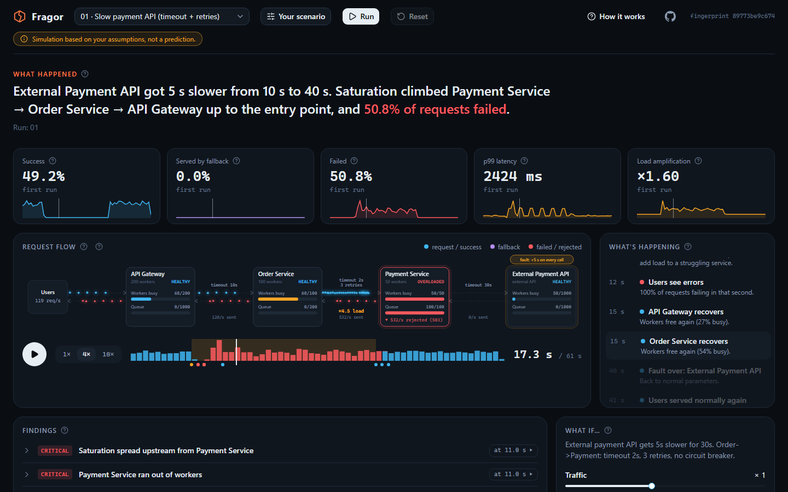

<p align="center">
  
</p>

<h1 align="center">Fragor</h1>

<p align="center"><strong>Break your architecture before production does.</strong></p>

<p align="center">
  <a href="https://github.com/salamancacm/fragor/actions/workflows/ci.yml"></a>
  <a href="https://salamancacm.github.io/fragor/"></a>
  <a href="LICENSE"></a>
  
  
</p>

<p align="center">
  <a href="https://salamancacm.github.io/fragor/"><b>Live demo</b></a> ·
  <a href="docs/USAGE.md">Guide</a> ·
  <a href="docs/CONNECT-PLAN.md">Roadmap</a> ·
  <a href="docs/ARCHITECTURE.md">Architecture</a>
</p>

*Fragor* (Latin: the crash of something breaking) is a deterministic simulator for microservice
resilience. You describe an architecture, inject a fault or a traffic spike, and watch the trouble
spread from service to service, second by second. Then you change a timeout, a retry count or a
circuit breaker and see how the outcome changes. Policy names and parameters mirror MicroProfile
Fault Tolerance / SmallRye, so a later export to Quarkus is straightforward.

> ⚠️ **A simulation is not a prediction.** Results depend on the parameters you assume. The value
> is in understanding mechanisms (how a failure propagates, which policy contains it), not in exact
> numbers. Every number shown anywhere in Fragor is computed by the engine from your scenario.



## Try it

**[Open the live demo](https://salamancacm.github.io/fragor/)**: nothing to install, the simulation
runs in your browser and nothing is sent anywhere. The first visit offers a guided tour.

- **Watch** a run replay as it happens: requests and answers as moving dots, services filling up
  and turning red, circuit breakers opening, retry storms, a narrated feed of what happens.
- **Understand** why: findings computed by fixed rules (no AI), each with the numbers behind it.
- **Change and compare**: timeouts, retries, circuit breaker, traffic. Every number is compared
  with the previous run.
- **Model your own system** with the *Your scenario* panel: a quick form (one service and one
  dependency) or any architecture as JSON.

> Fragor does not connect to your services **yet**: you describe them with numbers from your
> configuration and metrics. Connecting running services is planned, see the
> [roadmap](docs/CONNECT-PLAN.md).

## What the engine models

- Services and external APIs with workers, bounded FIFO queues (503 load shedding), service time
  distributions, error rates and dependency calls; blocking or async workers.
- Network legs with latency and packet loss.
- Client policies per edge, composed as `Fallback(Retry(CircuitBreaker(Timeout(Bulkhead(...)))))`
  with MicroProfile Fault Tolerance / SmallRye semantics, checked against the official
  documentation; anything that could not be verified is marked as such in
  [docs/SEMANTICS.md](docs/SEMANTICS.md).
- Timeouts that leave orphaned work running, drop the queued work of a caller that left, or cancel
  everything, and timeouts that run late when the caller's own threads are busy.
- Faults: added latency, error rates, outages, capacity loss, packet loss, traffic surges.
- Deterministic results: the same scenario and seed give the same numbers, bit for bit, in Node
  and in the browser. Plain versioned JSON in and out, with a fingerprint of every result.

### Checked against real services

[`examples/quarkus-demo`](examples/quarkus-demo/README.md) holds real Quarkus services, a k6 load
test and the matching Fragor scenarios. Across six combinations of load and timeout configuration,
the model matched the real services within 1.6 percentage points of success rate and 0.2 s on
latency percentiles. The runs that disagreed taught the engine two behaviors it now models.

## Command line

```bash
pnpm install
pnpm build
node packages/cli/dist/fragor.mjs run packages/scenarios/examples/01-payment-slow-baseline.json
node packages/cli/dist/fragor.mjs compare packages/scenarios/examples/01-payment-slow-baseline.json packages/scenarios/examples/02-payment-slow-with-breaker.json
```

The first command prints the outcome of a slow payment provider behind timeouts and retries, plus
findings such as the cascade of saturated workers. The second shows what a circuit breaker with a
fallback changes. What-if from the command line:
`--set edges.order-payment.policies.timeout.valueMs=1500`. The full guide is
[docs/USAGE.md](docs/USAGE.md); the scenario format has a
[JSON Schema](packages/scenarios/schema/scenario.schema.json) and six
[canonical scenarios](docs/SCENARIOS.md).

## Roadmap

Done: engine, resilience policies, scenarios and findings, CLI, web app with an animated replay,
your own scenario in the browser, a first-visit guide, and validation against real Quarkus services.

Next: **connecting running services** (local or real) by importing the telemetry they already
produce (OpenTelemetry traces, Prometheus metrics, configuration) into a calibrated scenario, with
a report of how well the model reproduces what was observed. The plan is in
[docs/CONNECT-PLAN.md](docs/CONNECT-PLAN.md).

## Development

Requires pnpm. Node 24 is pinned per project: pnpm downloads it on install.

```bash
pnpm install
pnpm lint && pnpm typecheck && pnpm test
pnpm bench      # performance budget of the engine
pnpm web:dev    # http://localhost:3000
```

See [docs/ARCHITECTURE.md](docs/ARCHITECTURE.md), [docs/SEMANTICS.md](docs/SEMANTICS.md) and
[docs/DECISIONS.md](docs/DECISIONS.md) for how it is built and why.

## License

[Apache License 2.0](LICENSE). See also [NOTICE](NOTICE).
